# From ultrasound tongue image sequences to intelligible speech reconstruction in a closed-set evaluation

Supplementary material for the manuscript

> **From ultrasound tongue image sequences to intelligible speech reconstruction in a closed-set evaluation**
> Frigyes Viktor Arthur and Dávid Sztahó
> Department of Telecommunications and Artificial Intelligence,
> Budapest University of Technology and Economics, Budapest, Hungary
> *Manuscript under peer review.*

---

## Listen to the audio examples in your browser

Supplementary site:

### **<https://victorarthur.github.io/direct-aam-uti/>**

(GitHub's README sanitizer strips `<audio>`/`<video>` tags, so the players
are hosted on a static GitHub Pages page generated from `index.html` in
this same repository. The audio files and mel-spectrograms themselves
live under [`examples/`](examples/) and play with any browser's built-in
controls.)

---

## How the system works

Speech is **synthesised from a midsagittal ultrasound video of the tongue**.
A short window of 40 raw ultrasound frames (500 ms; 20 past and 19 future) is processed by a
convolutional encoder, concatenated and projected by one linear layer, and decoded into an 80-channel
mel-spectrogram frame; a pre-trained WaveGlow vocoder then converts the
predicted mel-spectrogram into an audible waveform. The same vocoder is
applied to the natural-speech reference, so listening tests compare two
conditions that differ only in the mapping stage (matched-vocoder protocol). In the article the objective evaluation is repeated with a second fixed vocoder, HiFi-GAN, as a robustness check; the examples below are the WaveGlow renderings used in the listening test.

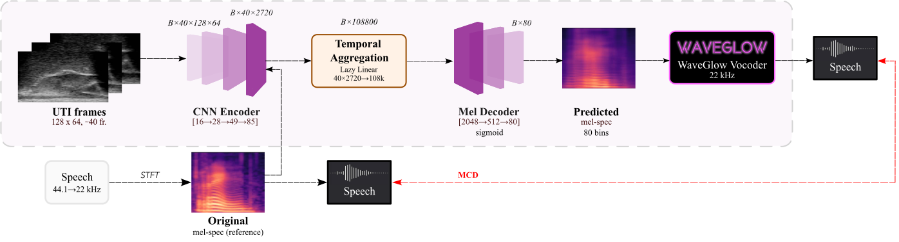

Two example utterances and their model outputs are shown below: top rows are
the input UTI frames at four time-points within the utterance; below are the
original and predicted mel-spectrograms.

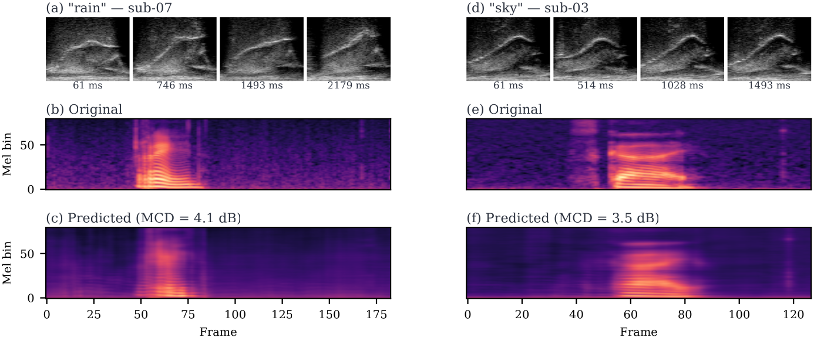

---

## Abstract

Silent speech interfaces must reconstruct speech from articulatory measurements alone. We show that isolated words reconstructed from sequences of midsagittal ultrasound tongue images (UTI) are intelligible in a closed-set test, and that the reconstruction runs faster than real time. A convolutional network maps a 500-ms window of UTI frames, 20 past and 19 future, directly to the 80-band mel-spectrogram frame at its centre, and a fixed, pre-trained neural vocoder generates the waveform. Its architecture was selected in a 313-trial search, and a controlled retraining showed that the frame sequence matters: a single repeated frame in the same network raised the mapping-stage mel-cepstral distortion from 4.03 to 5.16 dB in all twelve speaker–session models. Models were trained per speaker and session on 1,200 English words from four Hungarian native speakers. In a blinded eight-alternative forced-choice test, 31 listeners identified the reconstructed words in 84.0% of 620 trials (chance 12.5%), against 99.7% for the same vocoder driven by the natural mel-spectrogram; inter-rater agreement was substantial (Fleiss’ κ = 0.75) and the errors concentrated on consonant contrasts, such as *door*–*four*, that the midsagittal image does not capture. On one GPU the model needs 5.9 ms per window and the complete chain runs at a real-time factor of 0.52, with an algorithmic latency of about 230 ms. Repeating the objective evaluation with a second vocoder (HiFi-GAN instead of WaveGlow) lowers the mel-cepstral distortion between vocoded reference and reconstruction from 4.46 to 3.83 dB but leaves the ranking of utterances (ρ = 0.94) and the size of the mapping error unchanged. Open-vocabulary intelligibility was not tested.

---

## Audio examples

<p><span style="display:inline-block;padding:0.15em 0.55em;background:#fff5eb;color:#cc5e00;border:1px solid #fb8500;border-radius:4px;font-weight:700">PREDICTED &mdash; synthesized from ultrasound</span> &nbsp; <span style="display:inline-block;padding:0.15em 0.55em;background:#ecfaf6;color:#1f7a6a;border:1px solid #2a9d8f;border-radius:4px;font-weight:700">REFERENCE &mdash; natural mel-spectrogram, same vocoder</span></p>

**Click any spectrogram** to open the corresponding audio file on GitHub,
where the browser renders an inline audio player.

Each pair was rendered by the same WaveGlow model: the reconstruction from the mel-spectrogram predicted from ultrasound, the reference from the mel-spectrogram of the natural recording (matched-vocoder protocol). These are the stimuli of the listening test.

<a id="bring"></a>
### *bring*

#### sub-06 / ses-01

<table>
<tr><th style="background:#fff5eb;color:#cc5e00;border-top:3px solid #fb8500">PREDICTED &mdash; synthesized from ultrasound (click to play)</th><th style="background:#ecfaf6;color:#1f7a6a;border-top:3px solid #2a9d8f">REFERENCE &mdash; natural mel-spectrogram, same vocoder (click to play)</th></tr>
<tr><td style="background:#fff5eb;border:2px solid #fb8500"><a href="examples/top12_sub-06_ses-01_bring_predicted.wav">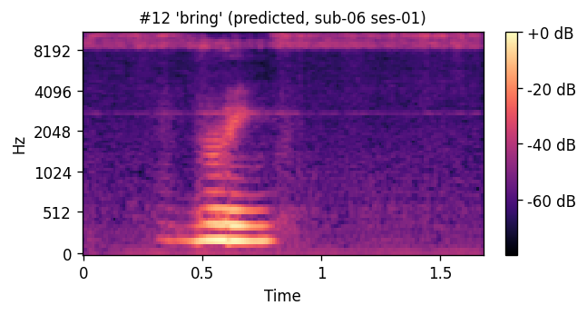</a></td><td style="background:#ecfaf6;border:2px solid #2a9d8f"><a href="examples/top12_sub-06_ses-01_bring_original.wav"></a></td></tr>
</table>

<a id="dance"></a>
### *dance*

#### sub-02 / ses-01

<table>
<tr><th style="background:#fff5eb;color:#cc5e00;border-top:3px solid #fb8500">PREDICTED &mdash; synthesized from ultrasound (click to play)</th><th style="background:#ecfaf6;color:#1f7a6a;border-top:3px solid #2a9d8f">REFERENCE &mdash; natural mel-spectrogram, same vocoder (click to play)</th></tr>
<tr><td style="background:#fff5eb;border:2px solid #fb8500"><a href="examples/top07_sub-02_ses-01_dance_predicted.wav">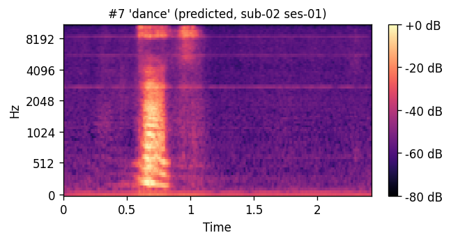</a></td><td style="background:#ecfaf6;border:2px solid #2a9d8f"><a href="examples/top07_sub-02_ses-01_dance_original.wav">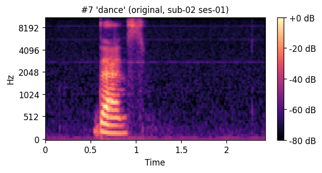</a></td></tr>
</table>

<a id="four"></a>
### *four*

#### sub-03 / ses-01

<table>
<tr><th style="background:#fff5eb;color:#cc5e00;border-top:3px solid #fb8500">PREDICTED &mdash; synthesized from ultrasound (click to play)</th><th style="background:#ecfaf6;color:#1f7a6a;border-top:3px solid #2a9d8f">REFERENCE &mdash; natural mel-spectrogram, same vocoder (click to play)</th></tr>
<tr><td style="background:#fff5eb;border:2px solid #fb8500"><a href="examples/top14_sub-03_ses-01_four_predicted.wav">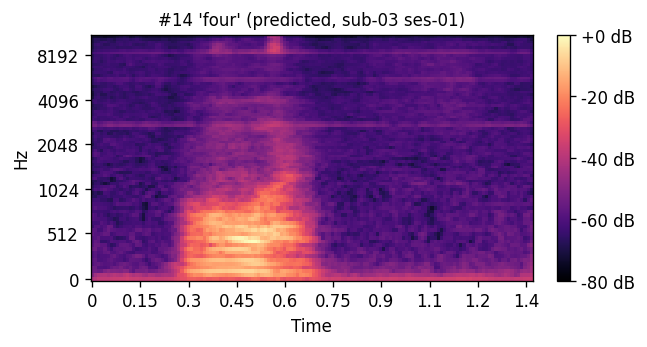</a></td><td style="background:#ecfaf6;border:2px solid #2a9d8f"><a href="examples/top14_sub-03_ses-01_four_original.wav">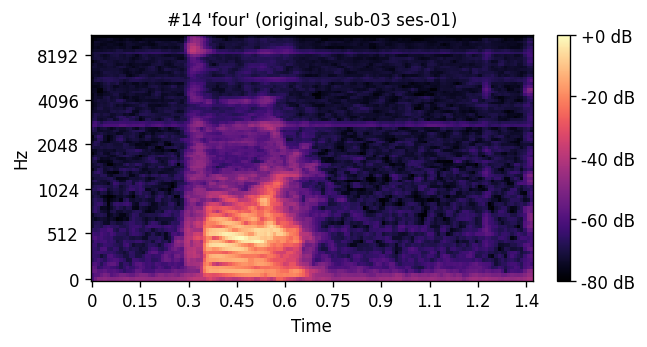</a></td></tr>
</table>

<a id="laugh"></a>
### *laugh*

#### sub-06 / ses-02

<table>
<tr><th style="background:#fff5eb;color:#cc5e00;border-top:3px solid #fb8500">PREDICTED &mdash; synthesized from ultrasound (click to play)</th><th style="background:#ecfaf6;color:#1f7a6a;border-top:3px solid #2a9d8f">REFERENCE &mdash; natural mel-spectrogram, same vocoder (click to play)</th></tr>
<tr><td style="background:#fff5eb;border:2px solid #fb8500"><a href="examples/top04_sub-06_ses-02_laugh_predicted.wav">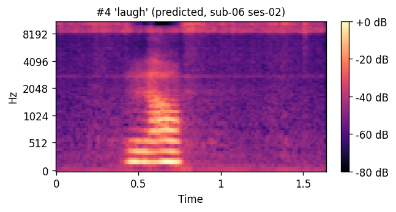</a></td><td style="background:#ecfaf6;border:2px solid #2a9d8f"><a href="examples/top04_sub-06_ses-02_laugh_original.wav">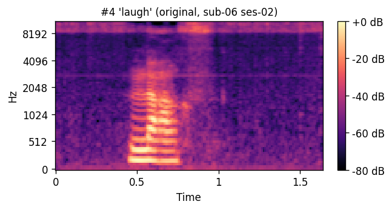</a></td></tr>
</table>

<a id="rain"></a>
### *rain*

#### sub-03 / ses-01

<table>
<tr><th style="background:#fff5eb;color:#cc5e00;border-top:3px solid #fb8500">PREDICTED &mdash; synthesized from ultrasound (click to play)</th><th style="background:#ecfaf6;color:#1f7a6a;border-top:3px solid #2a9d8f">REFERENCE &mdash; natural mel-spectrogram, same vocoder (click to play)</th></tr>
<tr><td style="background:#fff5eb;border:2px solid #fb8500"><a href="examples/top09_sub-03_ses-01_rain_predicted.wav">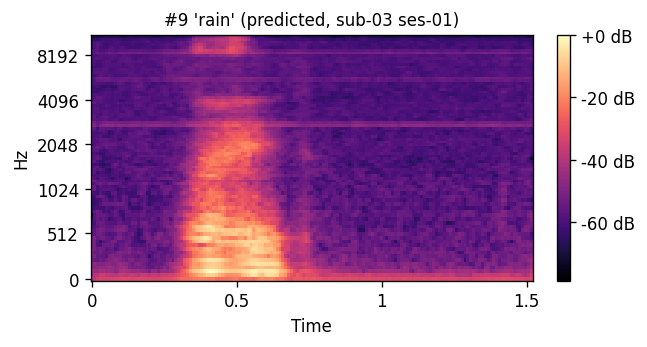</a></td><td style="background:#ecfaf6;border:2px solid #2a9d8f"><a href="examples/top09_sub-03_ses-01_rain_original.wav">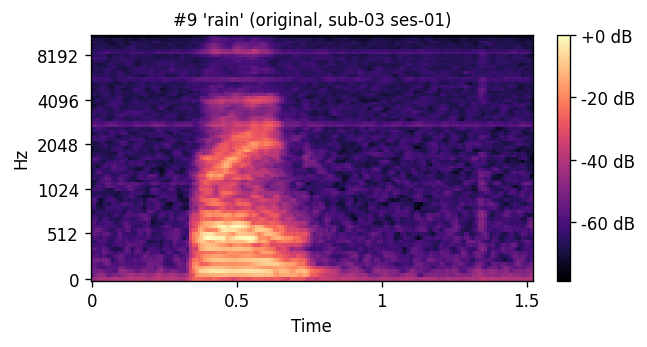</a></td></tr>
</table>

<a id="sad"></a>
### *sad* &mdash; 3 examples

#### sub-03 / ses-01

<table>
<tr><th style="background:#fff5eb;color:#cc5e00;border-top:3px solid #fb8500">PREDICTED &mdash; synthesized from ultrasound (click to play)</th><th style="background:#ecfaf6;color:#1f7a6a;border-top:3px solid #2a9d8f">REFERENCE &mdash; natural mel-spectrogram, same vocoder (click to play)</th></tr>
<tr><td style="background:#fff5eb;border:2px solid #fb8500"><a href="examples/top01_sub-03_ses-01_sad_predicted.wav">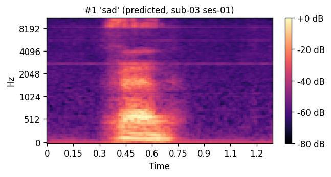</a></td><td style="background:#ecfaf6;border:2px solid #2a9d8f"><a href="examples/top01_sub-03_ses-01_sad_original.wav">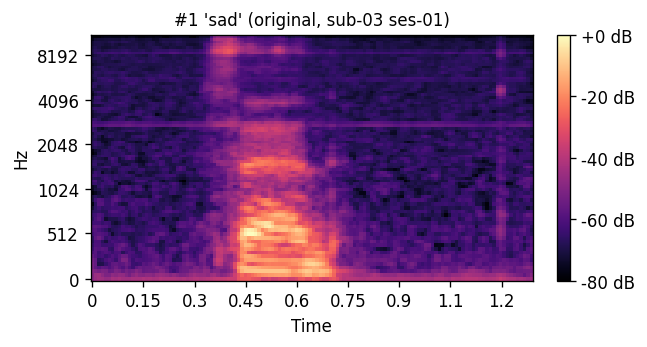</a></td></tr>
</table>

#### sub-06 / ses-02

<table>
<tr><th style="background:#fff5eb;color:#cc5e00;border-top:3px solid #fb8500">PREDICTED &mdash; synthesized from ultrasound (click to play)</th><th style="background:#ecfaf6;color:#1f7a6a;border-top:3px solid #2a9d8f">REFERENCE &mdash; natural mel-spectrogram, same vocoder (click to play)</th></tr>
<tr><td style="background:#fff5eb;border:2px solid #fb8500"><a href="examples/top02_sub-06_ses-02_sad_predicted.wav">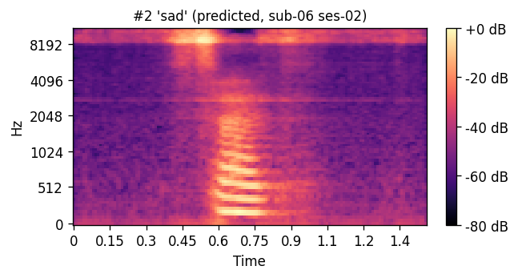</a></td><td style="background:#ecfaf6;border:2px solid #2a9d8f"><a href="examples/top02_sub-06_ses-02_sad_original.wav">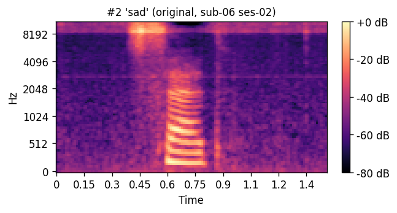</a></td></tr>
</table>

#### sub-06 / ses-01

<table>
<tr><th style="background:#fff5eb;color:#cc5e00;border-top:3px solid #fb8500">PREDICTED &mdash; synthesized from ultrasound (click to play)</th><th style="background:#ecfaf6;color:#1f7a6a;border-top:3px solid #2a9d8f">REFERENCE &mdash; natural mel-spectrogram, same vocoder (click to play)</th></tr>
<tr><td style="background:#fff5eb;border:2px solid #fb8500"><a href="examples/top03_sub-06_ses-01_sad_predicted.wav">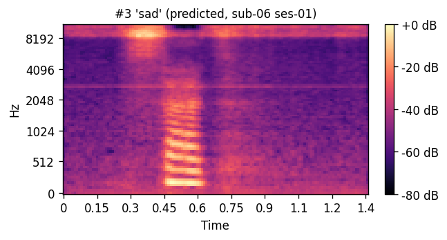</a></td><td style="background:#ecfaf6;border:2px solid #2a9d8f"><a href="examples/top03_sub-06_ses-01_sad_original.wav">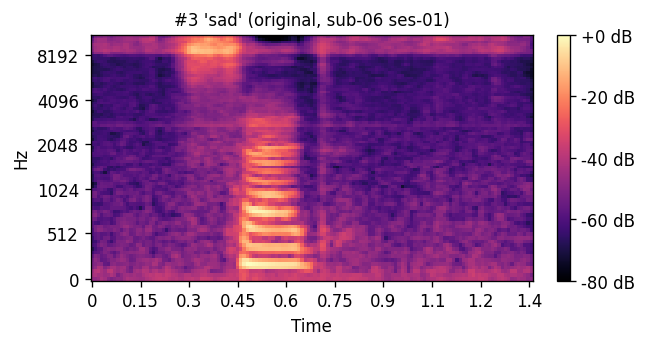</a></td></tr>
</table>

<a id="sky"></a>
### *sky*

#### sub-02 / ses-01

<table>
<tr><th style="background:#fff5eb;color:#cc5e00;border-top:3px solid #fb8500">PREDICTED &mdash; synthesized from ultrasound (click to play)</th><th style="background:#ecfaf6;color:#1f7a6a;border-top:3px solid #2a9d8f">REFERENCE &mdash; natural mel-spectrogram, same vocoder (click to play)</th></tr>
<tr><td style="background:#fff5eb;border:2px solid #fb8500"><a href="examples/top05_sub-02_ses-01_sky_predicted.wav">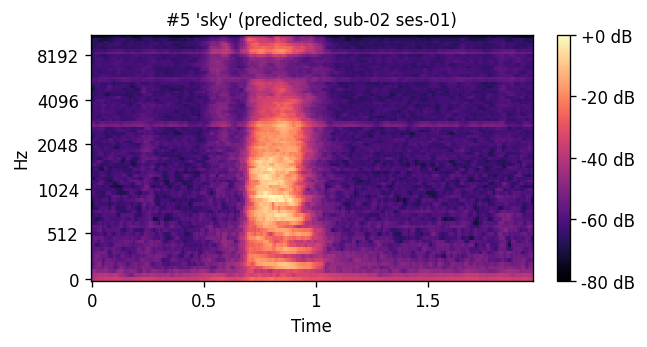</a></td><td style="background:#ecfaf6;border:2px solid #2a9d8f"><a href="examples/top05_sub-02_ses-01_sky_original.wav">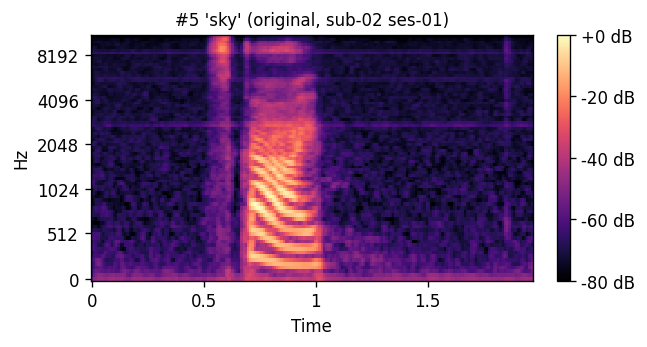</a></td></tr>
</table>

---

A plain-text index of the same audio examples is also available in
[`examples/INDEX.md`](examples/INDEX.md).

---

## Matched-vocoder evaluation protocol

The evaluation follows a **matched-vocoder protocol**: in the listening test, both the predicted and the
natural mel-spectrograms are inverted by the **same** pre-trained WaveGlow
vocoder. This ensures that any artefact introduced by the waveform generator
is shared across the two conditions and that any difference in listener
recognition reflects only the quality of the UTI-to-mel-spectrogram
prediction. In the article the same protocol is applied with a second fixed vocoder (HiFi-GAN) as an objective robustness check.

---

## Repository layout

```
direct-aam-uti/
├── README.md this file (mel images embedded; click to play audio)
├── index.html supplementary site (GitHub Pages, inline players)
├── LICENSE CC BY 4.0
├── CITATION.cff machine-readable citation metadata
├── .gitignore
├── figures/
│ ├── pipeline.png
│ └── data_results.png
└── examples/
 ├── INDEX.md
 ├── topNN_<spk>_<ses>_<word>_predicted.wav (5 files)
 ├── topNN_<spk>_<ses>_<word>_original.wav (5 files)
 ├── topNN_<spk>_<ses>_<word>_predicted_mel.png (5 files)
 └── topNN_<spk>_<ses>_<word>_original_mel.png (5 files)
```

---

## How to cite

Until the article is published, please cite this repository directly via the
GitHub "Cite this repository" button (powered by the `CITATION.cff` file in
the root) or use the placeholder BibTeX entry below:

```bibtex
@unpublished{arthur2026directaam,
 author = {Arthur, Frigyes Viktor and Sztah{\'{o}}, D{\'{a}}vid},
 title = {From ultrasound tongue image sequences to intelligible speech reconstruction in a closed-set evaluation},
 year = {2026},
 note = {Manuscript under peer review.}
}
```

A final BibTeX entry will be added here once the article is accepted.

---

## License

Unless otherwise stated, the contents of this repository are released under
[**Creative Commons Attribution 4.0 International (CC BY 4.0)**](https://creativecommons.org/licenses/by/4.0/).
You are free to share and adapt the material for any purpose, provided
appropriate credit is given to the authors and the article is cited.

The audio recordings included in `examples/` were collected with the written
informed consent of the four speakers; consent covers public release of these
specific stimuli for the purpose of accompanying scientific publications.

---

## Acknowledgements

This research was supported by the National Research, Development and
Innovation Office of Hungary (project FK 142163). Frigyes Viktor Arthur
acknowledges the financial support of the ÚNKP-22-2-I-BME-352 New National
Excellence Program of the Ministry for Culture and Innovation from the source
of the National Research, Development and Innovation Fund.

We dedicate this work to the memory of **Tamás Gábor Csapó**, whose vision
and leadership were instrumental in initiating this research.

---

## Contact

Frigyes Viktor Arthur
Department of Telecommunications and Artificial Intelligence,
Budapest University of Technology and Economics, Budapest, Hungary
arthur@tmit.bme.hu